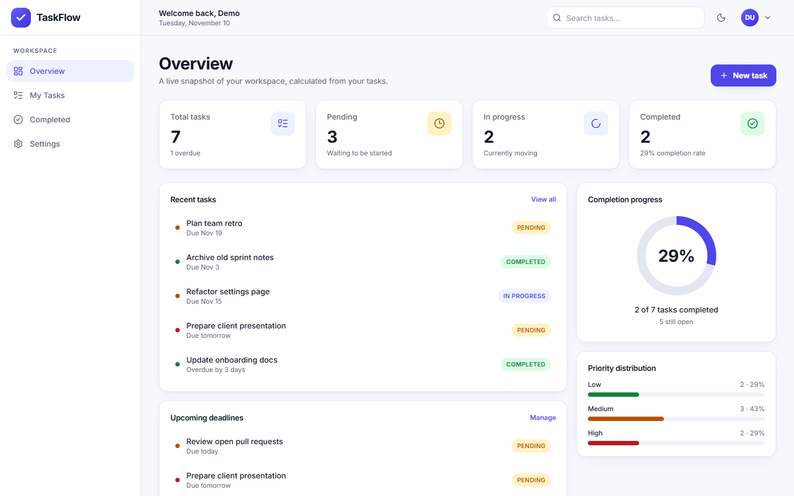
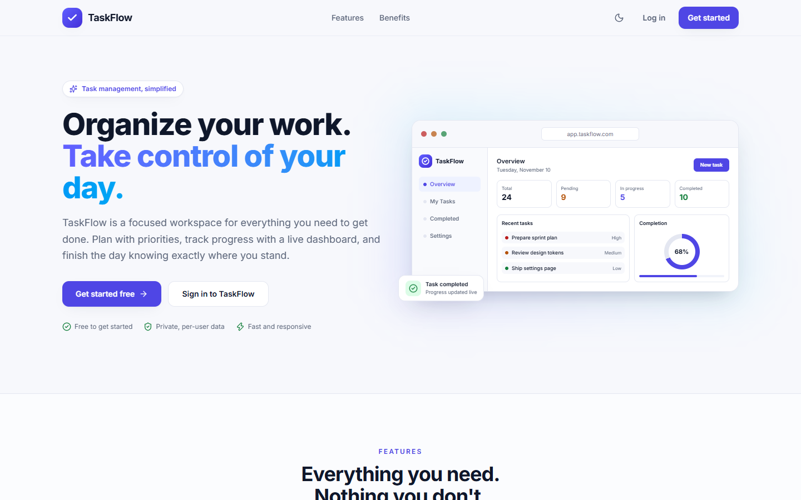
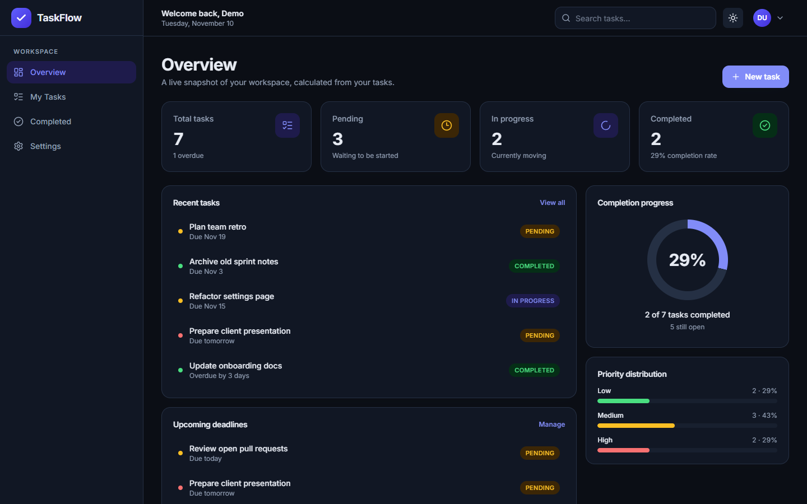
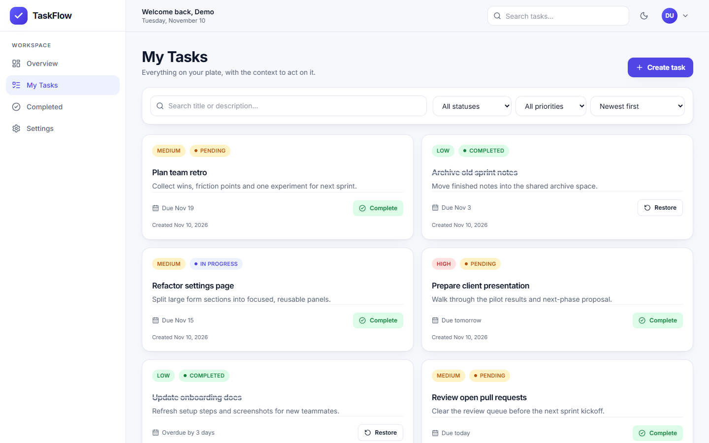
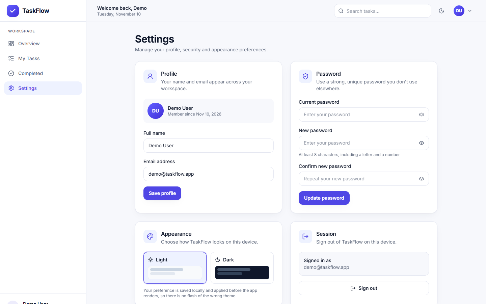
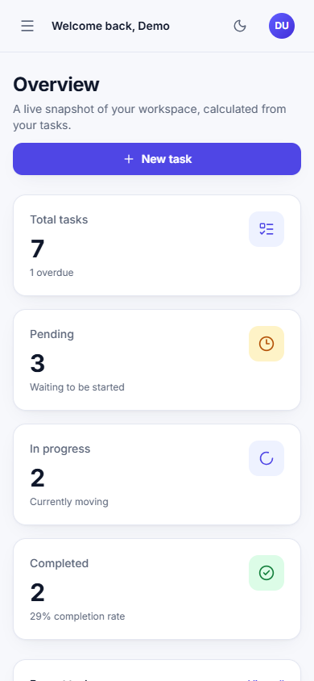
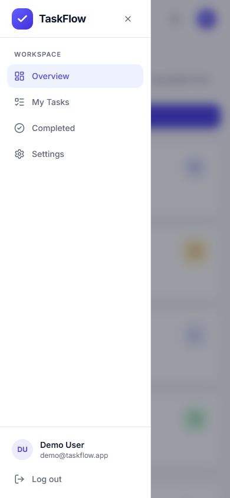

# TaskFlow

A production-minded task manager built with the MERN stack. TaskFlow pairs a calm, responsive React interface with a hardened Express API: cookie-based JWT sessions, per-user data isolation, server-side dashboard analytics, and a dark mode that is applied before the first paint.



## Screenshots

| Landing | Dark dashboard |
| --- | --- |
|  |  |

| My Tasks | Settings |
| --- | --- |
|  |  |

| Mobile dashboard | Mobile navigation |
| --- | --- |
|  |  |

Additional captures: [completed tasks](docs/screenshots/completed.png), [login](docs/screenshots/login.png), [register](docs/screenshots/register.png), [landing in dark mode](docs/screenshots/landing-dark.png).

## Features

- **Authentication**: register, sign in, session restore, logout, profile updates, password changes. JWT stored in an `HttpOnly` cookie.
- **Task management**: create, edit, delete, complete, restore, and change status. Title, description, priority (Low/Medium/High), status (Pending/In Progress/Completed), and due date.
- **Server-side analytics**: dashboard totals, completion rate, overdue count, priority distribution, recent tasks, and upcoming deadlines computed with a single aggregation.
- **Find anything fast**: debounced full-text search across title and description, status and priority filters, and four sort orders with null due dates pushed last.
- **Thoughtful UX**: loading skeletons, empty states, inline validation, toast feedback, confirm dialogs, keyboard-friendly modals, focus-visible rings, and reduced-motion support.
- **Light and dark themes**: persisted in `localStorage`, applied before React mounts to avoid a flash of the wrong theme.
- **Responsive shell**: desktop sidebar, mobile drawer, sticky header, adaptive grids, and no horizontal overflow at 390 px or 1440 px.
- **Security defaults**: Helmet headers, strict CORS allow-list, CSRF origin guard, auth rate limiting, bcrypt hashing, input allow-lists, and ownership checks on every task query.

## Tech stack

| Layer | Tools |
| --- | --- |
| Frontend | React 19, Vite 8, React Router 7, Tailwind CSS 4, Axios, Lucide icons, react-hot-toast |
| Backend | Node.js 20, Express 5, Mongoose 9, JWT, bcryptjs, Helmet, express-rate-limit |
| Database | MongoDB Atlas |
| Tooling | Oxlint, npm, Render, Vercel |

## Project structure

```text
task management/
├── backend/
│   ├── config/db.js              # Mongo connection, optional DNS override
│   ├── controllers/              # auth, task, user handlers
│   ├── middleware/               # auth, errors, rate limit, CSRF origin guard
│   ├── models/                   # User and Task schemas
│   ├── routes/                   # /api/auth, /api/tasks, /api/users
│   ├── tests/api-smoke.js        # 74-check HTTP integration suite
│   ├── utils/                    # validation, token, cookie helpers
│   └── server.js
├── frontend/
│   ├── src/
│   │   ├── components/           # cards, modals, navigation, feedback states
│   │   ├── context/              # AuthContext, ThemeContext
│   │   ├── hooks/                # debounce, click-outside
│   │   ├── layouts/              # dashboard shell, auth split layout
│   │   ├── pages/                # landing, auth, dashboard, tasks, settings
│   │   ├── services/             # Axios client and API wrappers
│   │   └── utils/                # constants, formatting, validation
│   └── vercel.json
├── docs/screenshots/
└── render.yaml
```

## Quick start

Requirements: Node.js 20+, npm 10+, and a MongoDB Atlas cluster (or a local MongoDB URI).

### 1. Backend

```bash
cd backend
npm install
cp .env.example .env    # Windows: copy .env.example .env
```

Fill in `.env`:

```dotenv
NODE_ENV=development
PORT=5000
MONGO_URI=mongodb+srv://<user>:<password>@<cluster>/<db>?retryWrites=true&w=majority
MONGO_DB_NAME=taskflow
JWT_SECRET=<long random string>
JWT_EXPIRES_IN=7d
CLIENT_URL=http://localhost:5173
```

Generate a secret:

```bash
node -e "console.log(require('crypto').randomBytes(48).toString('hex'))"
```

Start the API:

```bash
npm run dev
```

The server connects to MongoDB before listening and exposes `GET /api/health`.

> Windows/VPN note: if Node fails Atlas SRV lookups with `querySrv ECONNREFUSED`, set `DNS_SERVERS=8.8.8.8,8.8.4.4` in `.env`. Leave it unset on Render.

### 2. Frontend

```bash
cd frontend
npm install
npm run dev
```

Open <http://localhost:5173>. Vite proxies `/api` to `http://localhost:5000`, so the auth cookie stays first-party during development. Leave `VITE_API_URL` empty locally.

## Environment variables

### Backend

| Variable | Required | Description |
| --- | --- | --- |
| `NODE_ENV` | Yes | `development` or `production`. Controls cookie flags. |
| `PORT` | No | Defaults to `5000`. Render injects its own port. |
| `MONGO_URI` | Yes | MongoDB Atlas connection string. |
| `MONGO_DB_NAME` | No | Database name when the URI has no path segment. Defaults to `taskflow`. |
| `JWT_SECRET` | Yes | Long random string. The server refuses to start without it. |
| `JWT_EXPIRES_IN` | No | Token/cookie lifetime, e.g. `7d`, `12h`. Defaults to `7d`. |
| `CLIENT_URL` | Yes | Allowed frontend origin(s), comma-separated, without a trailing slash. Used by CORS and the CSRF guard. |
| `DNS_SERVERS` | No | Comma-separated DNS resolvers for Atlas SRV lookups. Local troubleshooting only. |

### Frontend

| Variable | Required | Description |
| --- | --- | --- |
| `VITE_API_URL` | Production | API root including `/api`, without a trailing slash, e.g. `https://taskflow-api.onrender.com/api`. Leave empty in development. |

## API reference

Base URL: `/api`. All responses use `{ "success": boolean, "message"?: string, "data"?: object, "errors"?: string[] }`.

| Method | Endpoint | Auth | Description |
| --- | --- | --- | --- |
| `GET` | `/health` | No | Uptime, environment, and database state. |
| `POST` | `/auth/register` | No | Create an account. Sets the session cookie. |
| `POST` | `/auth/login` | No | Sign in. Sets the session cookie. |
| `GET` | `/auth/me` | Yes | Return the current user. |
| `POST` | `/auth/logout` | No | Clear the session cookie. |
| `POST` | `/tasks` | Yes | Create a task. |
| `GET` | `/tasks` | Yes | List tasks. Query: `search`, `status`, `priority`, `sort`. |
| `GET` | `/tasks/stats` | Yes | Dashboard counters, distribution, recent and upcoming tasks. |
| `GET` | `/tasks/:id` | Yes | Read one owned task. |
| `PUT` | `/tasks/:id` | Yes | Replace task details. |
| `PATCH` | `/tasks/:id/status` | Yes | Update only the status. |
| `DELETE` | `/tasks/:id` | Yes | Delete an owned task. |
| `GET` | `/users/profile` | Yes | Read the current profile. |
| `PUT` | `/users/profile` | Yes | Update name and email. |
| `PUT` | `/users/change-password` | Yes | Change password with the current one. |

Task payload:

```json
{
  "title": "Finalize Q4 roadmap",
  "description": "Align milestones and success metrics.",
  "priority": "High",
  "status": "In Progress",
  "dueDate": "2026-12-01T12:00:00.000Z"
}
```

`description` and `dueDate` are optional; send `dueDate: null` or `""` to clear it. Sort values: `createdAt_desc` (default), `createdAt_asc`, `dueDate_asc`, `dueDate_desc`. Due-date sorts keep nulls last.

## Security notes

- **Cookie sessions**: `HttpOnly`, `Path=/`, `SameSite=Lax` in development and `SameSite=None; Secure` in production (cross-site Vercel to Render). A Bearer header is also accepted for API clients.
- **CSRF**: mutating requests with an `Origin` header must match `CLIENT_URL`. Requests without an `Origin` (server-to-server clients) pass.
- **Rate limiting**: 30 requests per 15 minutes per IP on register and login.
- **Passwords**: at least 8 characters with a letter and a number, bcrypt cost 12, never serialized in responses.
- **Ownership**: task queries always include `user: req.user._id`; another user's task returns `404` rather than leaking existence.
- **Mass assignment**: controllers validate against allow-lists, so fields such as `user` or `createdAt` cannot be injected.
- **Headers and limits**: Helmet, JSON body limit of 10 KB, and no stack traces in production responses.

## Testing and quality

Backend integration suite (74 checks, real HTTP against the running API and Atlas):

```bash
cd backend
npm run dev       # terminal 1
npm test          # terminal 2
```

The suite covers registration, login, cookie flags, duplicate and weak-password handling, CSRF rejection, task CRUD, mass-assignment protection, search/filter/sort behavior, dashboard stats, cross-user ownership, profile updates, password changes, and rate limiting. It preserves no test data.

> The final rate-limit check intentionally exhausts the login limiter. Restart the API or wait 15 minutes before using the UI afterwards.

Frontend checks:

```bash
cd frontend
npm run lint
npm run build
```

The UI was also exercised in headless Chrome at 1440 x 900 and 390 x 844: registration, session restore, task creation/deletion, search and filters, completion and restore, password change, logout/login, theme switching, and the mobile drawer. Screenshots in `docs/screenshots/` come from that run. Note: logged-out visits produce the expected `401` for `/api/auth/me` in the browser console; it is the session probe, not an error state.

## Deployment

### API on Render

`render.yaml` defines a free Node web service rooted at `backend`.

1. Push the repository to GitHub.
2. In Render, create a new **Blueprint** from the repository.
3. Provide `MONGO_URI` and `CLIENT_URL` when prompted. `JWT_SECRET` is generated by Render.
4. Confirm the health check at `/api/health` is green.

Manual setup works too: root directory `backend`, build `npm ci`, start `npm start`, health check `/api/health`.

Atlas must allow Render's connections (for example, `0.0.0.0/0` on a free cluster) and the database user must be able to read and write `taskflow`.

Production startup fails fast if `MONGO_URI` or `JWT_SECRET` is missing, if the secret is shorter than 32 characters, or if `CLIENT_URL` is missing, not HTTPS, or contains a trailing slash/path. The health endpoint returns `503` whenever MongoDB is not connected, so Render can detect a degraded instance. The process also closes the HTTP server and Mongo connection gracefully on `SIGTERM`.

### Frontend on Vercel

`frontend/vercel.json` configures the Vite build, SPA rewrites, immutable asset caching, and production security headers (CSP, HSTS, anti-framing, permissions policy).

1. Import the repository in Vercel and set the root directory to `frontend`.
2. Add `VITE_API_URL=https://<your-render-service>.onrender.com/api`.
3. Deploy, then set Render's `CLIENT_URL` to the deployed Vercel origin (comma-separate multiple origins if needed) and redeploy the API.

Post-deploy checks:

- `https://<api>/api/health` reports `"database": "connected"`.
- The auth cookie is visible in DevTools as `taskflow_token`, `HttpOnly`, `Secure`, `SameSite=None`.
- Registering, refreshing, and logging out work across both domains.
- If you use custom domains, update both `CLIENT_URL` and `VITE_API_URL`. The CSP in `vercel.json` allows `connect-src` to `https://*.onrender.com` by default; add your API domain there as well.
- The WebSocket/API calls also need the CSP's `connect-src` entry to match the exact API origin pattern.

Render's free instance spins down when idle, so the first request after a pause can take a few seconds.

### Cookie reliability on Safari/Firefox

The default cross-site setup (Vercel origin calling an `onrender.com` API) uses a `SameSite=None; Secure` cookie. Chrome and Edge accept it, but Safari and Firefox may block third-party cookies. For broad production support, put both apps under one registrable domain, for example `app.example.com` and `api.example.com`; cookies are then first-party even with the current `SameSite=None` setting. Update `CLIENT_URL`, `VITE_API_URL`, and the CSP's `connect-src` accordingly. A Vercel `/api` reverse proxy to Render is another option if you prefer a single public origin.

## Scripts

| Location | Command | Purpose |
| --- | --- | --- |
| `backend` | `npm run dev` | API with nodemon. |
| `backend` | `npm start` | Production API. |
| `backend` | `npm test` | 74-check HTTP integration suite. |
| `frontend` | `npm run dev` | Vite dev server with `/api` proxy. |
| `frontend` | `npm run lint` | Oxlint. |
| `frontend` | `npm run build` | Production bundle. |
| `frontend` | `npm run preview` | Preview the built bundle. |

## License

MIT
